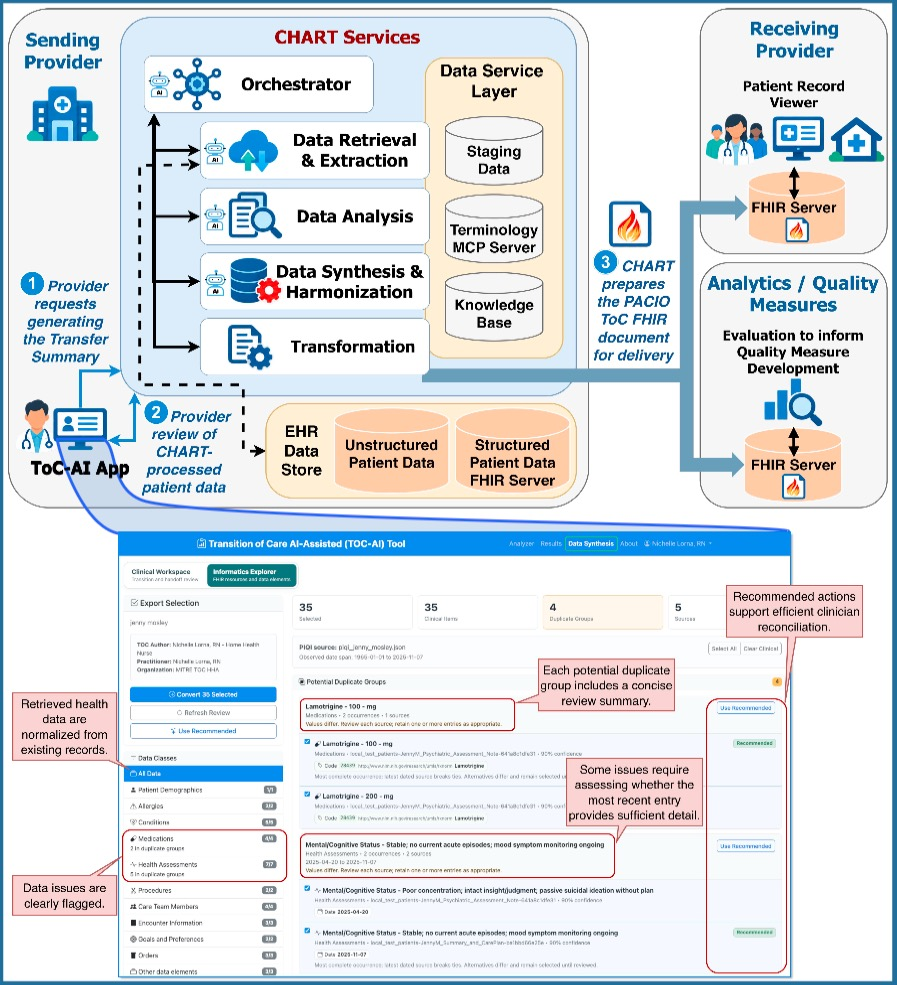

# PACIO Transition of Care AI-Assisted Proof of Concept Leveraging Clinical Health AI-augmented Records Toolkit (CHART)

 

Post-acute transitions are often hindered by
incomplete, fragmented, and inconsistently
represented handoff information. Clinical data
are scattered across EHR fields, notes, and
documents, resulting in duplication,
conflicting information, unclear data
provenance, and missing context. Receiving
teams must often reconstruct the patient’s
clinical story with inadequate information.
Why standards alone are insufficient
PACIO and FHIR enable standardized data
exchange but do not inherently support
clinical interpretation. They do not filter for
relevance, reconcile conflicting or duplicate
data, assess completeness or accuracy,
prioritize actionable information, or provide
the person-centric view needed for effective
care transitions.

A prototype was created to address this problem. It consisted of two complementary systems:

* **CHART**: a standards-led, AI-augmented toolkit of services that consolidate structured
& unstructured data into standardized & harmonized healthcare information.
* The **ToC-AI** (Transitions of Care AI-Assisted)
Application: leverages CHART services to organize transition-relevant information
while preserving clinician review, reconciliation, and source traceability, with the goal of
producing complete, meaningful, and timely information for the next care team.

 

 

## PACIO TOC-AI/CHART poster and supporting materials for AMIA Annual Symposium 2026

* [AMIA 2026 Annual Symposium Poster](./342_Terry.pdf)
* [TOC-AI/CHART Whitepaper](./AMIA-ToC-AI-Whitepaper.pdf)
